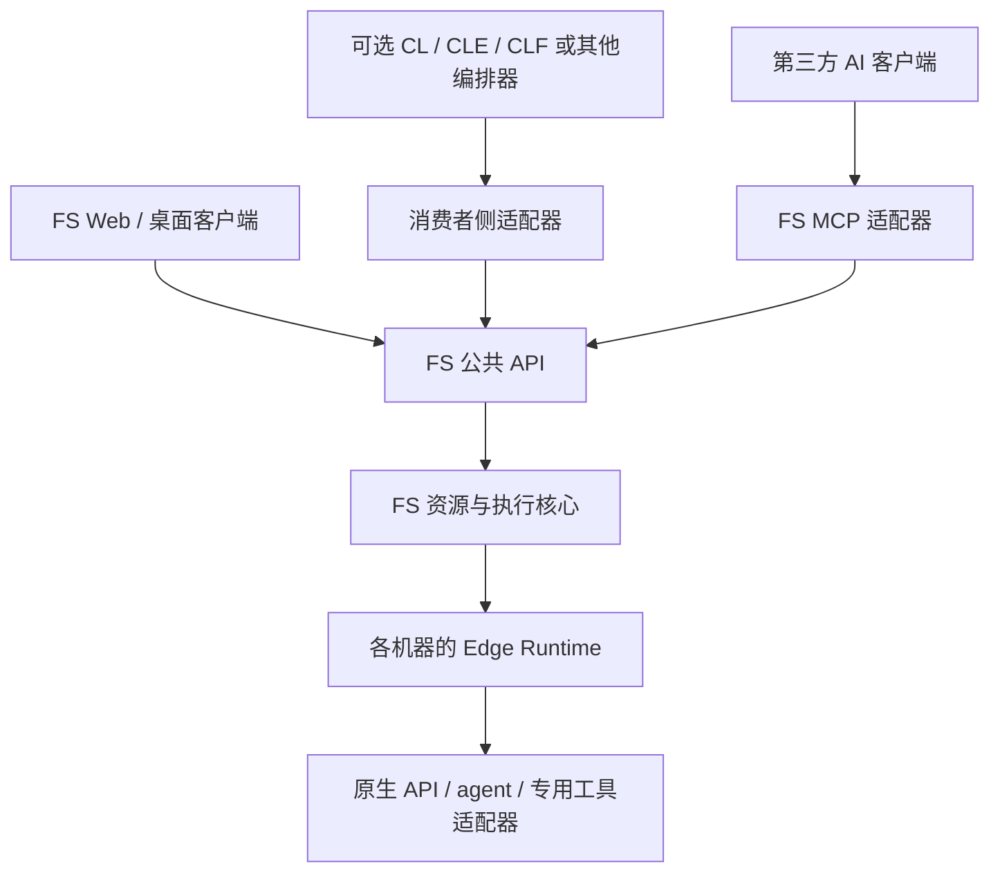

# FS MCP 与自有客户端的并行发展方案

- 日期：2026-10-31（Asia/Shanghai）。
- 状态：本轮 Owner 讨论的收敛记录与后续方案；仓库布局、接口名和阶段安排仍为提案。
- 前置阅读：[交互设计归档](resource-aware-prompt-design.md)、[接口核实报告](../research/client-completion-extension-audit-2026-10-31.md)。
- 本方案不解除 Baseline 0.0 的架构 gate；`ARCHITECTURE_0_1_READY=false`、`IMPLEMENTATION_AUTHORIZED=false`。

## 1. 本轮收敛

FS 以两个独立可用的入口发展，共享资源与执行能力：

- **L1 / FS MCP：** 接收格式明确的请求，查询资源、校验绑定、提交执行、取消和读取状态/结果。资源自动补全、宿主原生 mentions、灰字与候选框不作为 MVP 条件。
- **L3 / FS 自有客户端：** 承担资源补全、任务段编辑、绑定预览、多机资源视图、会话观察和全局时间轴。GUI 使用光标附近的候选列表；若以后做自有 TUI，再实现行内灰字。
- **L2 / 宿主内嵌前端：** 长期观察、机会性接入，不阻塞 L1/L3。DSH 等工具是否适合，应以实际前端扩展契约为准；普通工具插件不等于能读取光标或改写编辑器。

此前的 ChatGPT mentions 和 Codex 外部编辑器研究保留为证据与备选，但不再列为首批交付依赖。用户提到已有 DSH 开发跟踪周报；本轮不修改、复制或新增该自动化。

这里的并行指两个产品入口围绕共同契约独立推进，不要求第一天同时完成两个产品，也不等于建立两套执行系统。

## 2. 定位与共同核心

建议定位：**FS 连接不同机器、环境和 agent/client harness，把明确的资源选择转为可观察的执行；既能供 AI 工具调用，也提供统一的人机工作台。**

共同核心是无 GUI 的资源与执行服务，可独立于任何聊天客户端和 CL 系列运行。保留现有 Host、Environment、Workspace、NativeSession、LogicalSession、Command、ObservedState 概念；新的 Run 只是面向用户的一次执行记录，不承载业务 Goal 或通用 DAG。



公共 API 的初始形式可评估普通请求/响应加游标事件读取，不提前承诺完整技术栈。MCP 将通用接口包装为工具；FS 客户端直接调用相同 API。客户端不需要让模型调用 MCP 才能刷新资源列表或查看执行状态。

共同核心应拥有：资源身份/能力目录、绑定解析与校验、幂等命令、执行记录、取消请求、事件/结果引用。Edge Runtime 继续拥有真实本地进程、原生会话、命令 journal 和离线事件。MCP 进程或 UI 关闭不应使已受理任务失去所有者；远端任务生命周期不绑定某一条 MCP stdio 连接。

## 3. MCP 仓库与发布设计

### 首选：FleetSplice 同仓分模块，FS MCP 独立发布

当前核心契约尚未冻结，建议在现有 FleetSplice 仓库内划分职责，先不创建第二个产品仓库。以下是未来目录示意，本轮不创建这些源码目录或包清单；也不冻结编程语言。

```text
FleetSplice/
  docs/                       架构、研究、接口与验收设计
  packages/
    fs-contract/              版本化请求、资源、状态、事件定义
    fs-core/                  绑定、准入、执行记录和通用领域逻辑
    fs-runtime/               服务入口、Edge、持久化与 driver 宿主
    fs-mcp/                   MCP 工具映射、错误转换和连接配置
    fs-client/                Web 工作台与共享编辑组件
  apps/
    desktop/                  后期需要时添加桌面壳和本地集成
```

这只表达职责边界，不要求初版将每一项拆成单独包。首先做到依赖方向可检查、headless 和 UI 可分别交付，再决定物理拆分粒度。

`fs-mcp` 可以有独立入口、版本和安装说明，用户只安装 headless 运行组件即可使用，不要求安装 FS GUI。它通过版本化 API/轻量 SDK 连接 FS 服务，不复制执行状态机，也不直接承担远端会话监督。

同仓的理由：资源字段、幂等和事件契约仍会变化，同仓允许原子修改并验证 MCP/UI 的一致性；并行开发可以靠清晰模块所有权与 mock 契约完成，不必靠拆仓实现。

### 何时拆出 FleetSplice-MCP

只有出现以下实际需求再拆：公共 API 已稳定；MCP 维护者或发布节奏长期独立；外部用户需要复用适配器而不接触完整工作台工程。

届时独立仓库只包含 MCP adapter、通用 SDK 依赖、打包说明和契约兼容检查。它连接已安装的 FS runtime；如果提供便捷安装，应明确 runtime 的版本和启动/退出所有权。不把 Core/Edge 复制进新仓库，不引入 CLF 来填补运行能力，不让 MCP 与 GUI 各自产生一套 run_id 或资源目录。

独立 Git 仓库、独立可安装包、独立运行进程是三项不同决策。当前推荐同仓、可独立安装、运行所有权清楚。

## 4. L1：格式化输入与最小接口

### 输入设计

初版采用一个版本化结构化 RunSpec；GUI、MCP 和未来命令行都生成/提交它。先不维护互不兼容的自然语言 DSL、shell DSL 和 GUI 私有格式。

示意 JSON，名称和 ID 均为提案/样例，并非已存在的工具或资源：

```json
{
  "schema_version": "0.1",
  "request_id": "orbit-case-001",
  "target": {
    "environment_id": "skyforge-wsl-ubuntu",
    "workspace_id": "orbit-workspace",
    "runtime_id": "dsh-main"
  },
  "inference_profile_id": "qwen-skyforge-gpu",
  "tool_binding_ids": ["stk-skyforge-windows-user"],
  "limits": {"max_workers": 2},
  "prompt": "运行指定轨道场景并返回结果表。"
}
```

Environment 与目录中的 Host 关联；显示名称可以简短，最终绑定使用稳定 ID。显式绑定的推理和工具端点必须被所选 runtime 支持，否则拒绝该组合，不能把模型选择与跨机工具调用当作任何 harness 都自动支持的功能。不能落实的硬限制必须报错；偏好与强制约束另行区分。

候选接口族：

| 提案名称 | 职责 |
| --- | --- |
| `fs_resources` | 查询已授权资源、能力、观测时间和兼容信息 |
| `fs_validate` | 只读校验与归一化；可用于预览，不强制每次经过人工确认 |
| `fs_submit` | 接收结构化 spec 或其序列化文本，确定解析、校验、幂等受理 |
| `fs_get_run` | 读取受理、观察状态、实际绑定与结果引用 |
| `fs_cancel` | 请求取消；实际已停止必须等待执行端确认 |
| `fs_events` | 按执行 ID 与游标读取事件，可供无推送能力的客户端轮询 |

### 确定性与失败语义

用户在第三方聊天输入 JSON 或命令，并不等于 FS 已收到请求。MCP server 通常只收到宿主实际发出的工具调用；宿主模型仍可能不调用、重写或漏传字段。宣称“格式正确就必然执行”超出了 MCP 适配器的权力。

FS 能保证的是：收到请求之后由确定解析器与校验器处理，返回规范化 spec、实际资源绑定、FS run_id 与请求摘要；不再让第二个模型重新猜一次目标。对于必须直接传递原始输入的使用方式，提供 FS 客户端；以后可加不带补全的轻量命令入口，仍使用同一契约。

最低语义要求：

- `request_id` 在调用者身份范围内幂等；相同 ID/相同内容返回已有记录，相同 ID/不同内容拒绝。
- 将 accepted、running、完成结果和 unknown/reconciling 区分。受理成功不等于执行成功。
- 不承诺任意外部副作用的 exactly-once；派发结果未知时先核对本地 journal 与 native identity，不盲目重派。
- 显式目标不能因负载或离线自动换机器。负载带观测时间，提交时重新验证准入。
- 凭据引用、目录路径和操作权限由已登记环境及运行时解释；结构化命令不直接拼接成任意 shell 字符串。
- 事件/产物引用应关联同一个 run_id。取消命令也需要幂等，停止状态来自执行端。

## 5. L3：FS 客户端集成

建议先交付一个共享 Web UI，再根据本地集成需求增加桌面壳。Web 和桌面应复用输入组件、RunSpec、资源 API 和时间轴数据，而不是形成两套功能。

核心输入流程：

1. 用户编辑自然语言任务，并给当前任务段添加明确资源绑定。
2. 编辑器用资源目录与已有约束产生候选，显示环境/能力/负载信息。
3. 选择只替换当前 token/range；资源 ID 与任务段 scope 以结构化数据保存。
4. 发送前生成可查看的 RunSpec，直接调用 FS API。
5. 用户继续编辑其他任务，时间轴通过同一事件接口观察执行。

MCP 发起的任务应自动出现在 FS 工作台；UI 发起的任务也应能通过 MCP 查询。MVP 至少做到通过 run_id 查看、取消和关联结果。这里的“同一任务可观察”不等于可以无损迁移或接管任意 vendor-native 对话。

第一版界面范围：资源目录、一个 prompt 编辑器、任务/会话列表、执行详情、简化全局时间轴。跨机日志按来源 lane 展示；断连和缺失覆盖保持可见。桌面专属窗口控制、原生会话接管和复杂 history/handoff 在各自协议验证通过后增加。

同一编辑器中可以保留多个带稳定 scope ID 的任务段，每段先生成独立 RunSpec；它们的资源绑定不能因移动光标而泄漏到相邻段。组合提交与依赖执行是后续单独定义的操作，不能把排版顺序默认解释为执行依赖。

需要区分自有编辑器、桌面安装包、Native Control 三件事：完整补全需要控制编辑器，但可以先由 FS Web 实现；桌面壳提供本地集成；原生应用控制由对应机器的 Edge/driver 提供，MCP 和 UI 均可使用。拥有 FS 窗口并不会自动获得 ChatGPT 等应用未公开的控制接口。若关键能力只能经 UI 操作取得，应先验证可观察状态、可重复控制和失败恢复，再承诺支持。Native-first 的方向保留，但不能用桌面壳替代原生适配证据。

自有 TUI 与灰字是后续可复用同一补全逻辑的 renderer；不为拿到 Codex stock 输入框里的灰字而阻塞 GUI，也不以维护第三方 TUI fork 为 MVP 前提。

## 6. 不依赖 CL 的运行闭环

FS 必须在完全没有 CL/CLE/CLF 安装、代码、数据库或服务的环境中，独立完成资源登记、提交、执行、取消、观察与结果获取。这应成为未来验收条件。

| FS 自己负责 | 可选编排器负责 |
| --- | --- |
| 显式 placement、资源能力、命令准入、本地容量控制 | 业务 Goal、任意 DAG、验收与策略性重试 |
| 原生会话/进程实际状态和执行事件 | WorkOrder/claim/receipt 等外部任务模型 |
| 可追踪的结果、artifact 与 checkpoint 引用 | 判断结果是否满足业务验收，决定下一项任务 |
| 不透明的外部 correlation metadata | 解释这些 ID 在外部系统中的含义 |

依赖方向：`CL/CLE → CLF 的 FS provider/adapter → FS 公共 API/SDK`。适配器优先放在 CLF 一侧；FS 只维护中立契约、SDK 和兼容说明。FS 不导入 CL 的运行库或状态机，不要求先创建 CL Goal 才能运行任务。MCP 也不引入 CLF 作为隐藏的必需后端。

CL 可以经 MCP 快速试接，但长期确定性编排优先直接使用 FS API/SDK，避免再由聊天模型转译。CL 的任务分配与 FS 的资源准入是不同权威；未来适配时明确 claim/lease 到 generation/fencing 的映射，不让两套租约竞争控制同一次执行。

本轮可核实依据是本仓库的 [CL 集成边界](coordination-loop-integration.md)、[权威模型](authority-model.md) 和 [Edge Runtime 模型](host-runtime-model.md)。未在可发现的本地项目中找到 CL/CLE/CLF 仓库，因此以上不声明 CLF 当前已实现这些接口。

## 7. 没有 CL 时，多机联动做到哪里

第一步允许多个独立 run 分别绑定不同环境，并按中立的 group/correlation ID 聚合观察。调用方可以等待 A 的产物，再显式提交 B；手工用户可从结果继续创建任务。由此验证 A 在机器 1、B 在机器 2 的完整路径，不强制引入 CL。

若后续确实需要无人值守的 A→B 自动串接，再单独选择一个小的通用编排入口，或让外部编排器完成；不能把它隐含塞进 MCP adapter。有限串联、通用 DAG、自动跨机调度是不同的范围。MVP 不承诺从任意一段自然语言自动生成并可靠执行复杂 DAG。

全局时间轴可以先展示真实执行与调用方给出的关联，不需要 FS 自己拥有业务 DAG。推理端点/专用工具跨机路由也应单独验证：注册资源不等于某个 harness 已具备跨机调用能力。

事件契约应保留来源、来源内序号、发生时间与接收时间。跨机时钟有偏差时，时间轴不能只按墙钟排序就宣称存在因果关系；任务依赖和产物交接应使用显式关联。多机联动验收必须包含两个实际 Host，不能用同一 Host 内的两个环境代替。

## 8. 后续阶段与并行方式

下表是架构获准后的开发顺序；当前只准备设计和验收条件。

| 阶段 | 内容 | 最小验收 |
| --- | --- | --- |
| P0 契约收敛 | RunSpec、资源 ID、能力、受理/观察状态、事件与错误；保留现有 native/logical 分离 | 不引用 CL 类型；用同一组示例证明 MCP/UI 可表达相同任务 |
| P1 headless 纵向闭环 | 一个环境、一个已验证 structured driver、资源目录、持久化执行记录与 MCP adapter | 无 GUI、无 CL 可以提交/查询/取消；重复提交不重复派发；断开 MCP 后可重连观察 |
| P2 客户端并行推进 | UI 可先对契约样例开发；接通目录、编辑/补全、绑定预览与执行详情 | UI 与 MCP 发起的任务互相可见；中文 IME、撤销与作用域无误 |
| P3 两机异构闭环 | 第二环境/driver、结果交接、跨机事件关联、简化时间轴 | 两台机器的关联执行可追踪；离线不伪造完成；重连不盲目重派 |
| P4 原生能力与可选生态 | 桌面壳、原生专属适配、历史/handoff、可选 CL provider；继续观察 L2 | 逐项报告能力/限制；安装 CL 或 L2 插件不是此前阶段的前置条件 |

P1 和 P2 在 P0 的小契约明确后可以作为两个工作流推进；契约变更必须同时检验两个入口。优先让 headless 路径形成真实执行证据，UI 的静态演示不能替代执行验收。无需在现阶段承诺工期或同时接入所有 harness。

在投入复杂原生适配或桌面壳前，先挑一个业务上确实需要的 native-only 能力做有界验证：它能否被可靠触发、是否有稳定执行身份、能否观察完成和失败、断连后能否恢复。若结果否定某个 driver，缩小支持范围或更换接入路径，而不是假设独立客户端天然解决问题。

## 9. L2 的长期观察条件

不预先判定 L2 只适用于 DSH。满足以下条件的宿主均可重新评估：公开且可版本化的编辑器扩展点；可获得必要的文本/光标/作用域；能以低延迟查询资源；候选插入和键位契约足够稳定；维护成本显著低于自有入口的收益。

若只开放资源 mentions，可作为较窄的便捷集成，不等于完整 L2 编辑器。若仅开放工具调用，则按 L1 接入。研究发现记录为观察事项，不自动进入核心开发关键路径。

## 10. 本轮形成的决策建议

- 主路线：L1 + L3，共享无 GUI 的 FS 核心；L2 降为可选观察。
- 仓库：先 FleetSplice 同仓分模块、MCP 独立可安装/发布；契约成熟后再考虑独立适配器仓库。
- 交互：格式化请求用于 L1，补全与细粒度编辑集中到自有客户端。
- CL：可选消费者，适配器归消费者侧；FS 自身没有 CL 运行依赖。
- 执行：先显式资源选择、真实结果与恢复，再扩展原生专属能力和复杂联动。

相对之前讨论，变化的是交付优先级与依赖关系；资源语义、输入体验目标和已核实接口证据继续保留。
