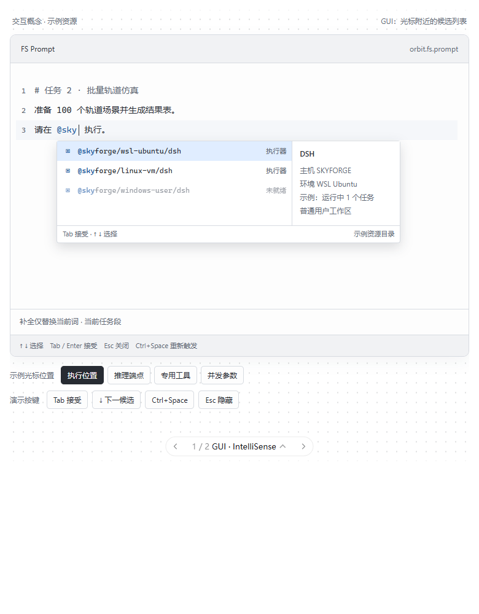
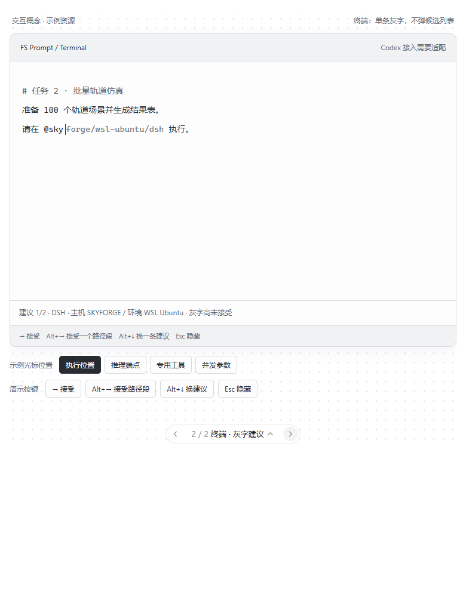

# FS 资源感知 Prompt 与异构执行工作台：设计归档

- 归档日期：2026-10-31（Asia/Shanghai）。
- 状态：Owner 对话中的需求与设计提案，尚未接受为实现基线。
- 仍遵循 [Baseline 0.0](baseline-0.0.md)：`ARCHITECTURE_0_1_READY=false`，`IMPLEMENTATION_AUTHORIZED=false`。
- 本文保存本轮可见对话中的设计，不声称已找回其他网页或桌面历史对话的全部结论。

## 1. 用户希望解决的问题

在手写同一段 prompt 时，就能细粒度指定每个任务使用哪台机器、哪个执行环境、哪个 agent/client harness、哪个推理端点、哪些专用工具，以及当前任务的并发约束。用户不希望离开写作过程，逐个填写资源表单或走分步选择向导。

资源选择需要包含真实异构性：Windows 用户会话中的 STK/MATLAB、Linux/WSL 中的开发 agent、另一台机器上的 GPU 推理端点，以及可能只在特定原生客户端中提供的能力。相同 provider 或模型名称不能证明两个 harness 的工具、上下文、权限和工作流相同。

这些是需求与需要验证的假设，不是任何客户端已经开放控制接口的证据。

## 2. FS、CLF 与 DSH 的建议边界

| 层 | 应承担的职责 | 本轮不应混入的职责 |
| --- | --- | --- |
| CL / CLE | 任务依赖、DAG、何时执行、验收与编排策略 | 原生客户端输入框、每台机器的进程控制 |
| CLF | 把编排意图转为可准入的执行请求，衔接 claim/lifecycle/receipt | 重做每种桌面客户端，另建一套相互竞争的执行权威 |
| FS | 资源目录、host/environment/workspace/session 连接、能力与状态报告、资源感知输入、执行观察工作台 | 把 CL 的 Goal/DAG 对象变成 FS 核心领域模型 |
| DSH 或其他 harness | 单个执行环境内的 agent 工作流、工具调用和本地多 agent 协作 | 默认拥有跨所有机器的全局调度权 |
| MCP / 宿主扩展 | 暴露资源与操作，或接入宿主明确开放的 UI 扩展点 | 仅凭接入 MCP 就假定能修改任意宿主输入组件 |

此划分沿用 [Coordination Loop 集成边界](coordination-loop-integration.md) 与 [Agent / InferenceProvider 分离](agent-and-provider-model.md)。CLF 当前能力及 DSH 当前接口必须另行核实；这里不是它们现有实现的声明。

## 3. 统一语义与候选来源

至少区分以下维度，不能用一个“模型选择”字段代替：

1. 执行位置：host + environment + workspace。
2. agent/client harness：例如已登记的 DSH 或 Codex 执行适配器。
3. 推理位置：provider、model/version、endpoint 与 inference host。
4. 专用工具位置：工具实例、所属用户会话、许可证与执行槽。
5. 当前任务的资源约束：例如 worker 并发上限、排队偏好；不等同于 OS CPU/GPU 强制限额。

候选来自已登记资源与能力目录。先根据当前位置和已经写下的约束筛选，再匹配用户输入。不可编造机器、可用模型、许可证或负载。负载是带时间戳的观察值，不能把示意图上的数字当成真实遥测。

示例记法（仅用于表达意图；`@`、字段名、路径顺序和正式语法尚未冻结）：

```text
# 任务 2 · 批量轨道仿真
准备 100 个轨道场景并生成结果表。
请在 @skyforge/wsl-ubuntu/dsh 执行。
推理使用 @qwen/skyforge-gpu。
仿真调用 @stk/skyforge/windows-user。
并发上限 2，资源繁忙时排队。
```

显示文本、稳定资源 ID、任务作用域和强制约束应分开。以后必须验证明确的任务段或结构化 binding 能否准确表示作用域；不能仅凭自然语言“最近出现的机器名”决定派发。

`@` 的设计初衷是写作时指定资源，并不要求占用所有宿主已有的 `@` 行为。第三方宿主可以走原生 mention 入口；FS 自有编辑器可以另定触发符。资源语义不应绑死在单一字符上。

## 4. GUI：VS Code 式候选列表

这是本轮用户纠正后的目标交互，优先于先前的分步资源选择器：

- 在当前资源词的光标附近展开紧凑候选列表；继续输入时过滤。
- 上下键移动，Tab/Enter 接受，Esc 关闭；手动触发键应允许按宿主能力调整。
- 候选包含名称与类型；可选详情区显示所属机器、环境、可用性、观测时间、许可证或容量。
- 只替换当前 token/range，保留前后文字和其他任务段。
- 接受后继续原来的 prompt；不强制打开下一步表单。
- 未就绪条目可以解释原因，但不能当成可立即执行的默认目标。
- 支持中文 IME、光标移动、中间插入、撤销、键盘导航与无障碍。



图片是本轮设计示意，资源与负载均为样例。它展示 FS 自有输入组件的目标体验，不是 ChatGPT 或 Codex 已实现能力的截图。

## 5. 终端：zsh 风格行内灰字

终端默认不弹候选列表，而在光标后显示一条灰色建议。例如已输入 `@sky`，灰字显示 `forge/wsl-ubuntu/dsh`。

- 灰字不属于已输入文本，不进入复制、发送或执行 binding；接受后才写入。
- 建议键位：右箭头接受全部，Alt+右箭头按路径段接受，Alt+下箭头切换建议，Esc 隐藏。Alt 绑定是 FS 提案，不是 zsh/Codex 的既有接口承诺。
- 尽量保留宿主 Tab 和 Enter 原有行为；终端灰字不能让 Enter 在用户未接受时偷偷插入建议。
- 可显示一行简短候选说明，帮助区分同名机器或环境。
- 候选多时先按语义和已知约束收窄；切换建议应稳定，避免实时负载刷新导致正在接受的候选跳动。
- 灰字来自同一资源目录与补全逻辑，不要求每次按键都调用模型生成自由文本。



此图是 FS 可控终端输入组件的示意，不是 stock Codex CLI 已接入自定义灰字 provider 的证明。shell 命令行、Codex TUI prompt、外部编辑器是三个不同输入表面。

## 6. 资源选择与执行语义

补全接受只是编辑动作。发送后还应经历资源解析、能力验证和执行准入，不能把“曾出现在候选中”当成资源租约。

- 稳定绑定：用户明确指定的目标不得因负载变化自动换成另一台机器。
- 陈旧状态：资源离线或许可证消失时应解释、排队或要求重新选择，不能默默改写约束。
- 模型边界：选择远端任务的推理端点，不表示修改当前 ChatGPT/Codex 对话模型。
- 并发边界：worker 上限、工具执行槽、GPU 容量、许可证是不同约束；默认不承诺 OS 层强制资源隔离。
- 端点分离：运行 agent 的机器、进行推理的机器和运行专用工具的机器可以不同。

## 7. 多机异构联动与全局时间轴

提案中的闭环是：prompt 中指定任务资源 → CL/CLE 表达依赖 → CLF 对接执行 → FS 连接异构环境 → DSH/原生 driver 执行 → 回传有来源的事件与结果。

FS 工作台可把相关事件放到统一时间轴中，按机器、执行环境、任务或 native session 分 lane，展示等待、执行、工具占用、失败和重试。依赖图与调度决定仍归编排层；FS 可以读取并呈现外部关联 ID。

时间轴不能把未收到的事件补画成成功。需记录事件来源、源时间、接收时间、顺序/游标与覆盖不完整状态，处理跨机时钟偏差和断连回补。harness 内部多个 agent 若没有可靠的子任务事件契约，先显示聚合执行片段，不伪造完整内部 DAG。

多机异构联动可以构成产品差异，但“有多个 agent”或“有甘特图”本身不证明创新。需要验证跨 host/environment/harness 的可操作性、权威边界和事件关联是否比已有工具更完整。

## 8. 独立开发必要性与最小验证范围

需求应拆成三个交付层，而不是预设必须先做完整 FS 桌面应用：

1. 资源与执行服务：先验证 MCP 能否提供目录查询、解析、状态与执行结果；UI 并非前提。
2. 输入适配层：利用宿主 mention/completion、外部编辑器或受支持扩展，让用户在写作时选资源。
3. FS 可控工作台：当宿主不开放所需输入行为，或用户需要统一跨机时间轴/会话观察时，提供 FS 自有编辑器与视图。它可能先是网页或嵌入式 MCP App，不必一开始就是独立桌面安装包。

若必须操作无公开控制 API 的原生 GUI，应单独验证可访问性/桌面控制能力、窗口与会话身份、恢复和可靠性；不能因为需要输入补全，就直接认定所有执行都需要 Native-first Control。

最小架构验证提案：两个 host/environment、一个可结构化控制的 agent/harness、一个异构专用工具或模拟能力、显式资源绑定、一条依赖链、一份可关联的结果与简化时间轴。默认人工明确选择位置；不扩展为自动异构调度器。这与 Baseline 0.0 的非目标边界一致。

先验证：

- Codex CLI 是否公开原位输入 completion provider；外部编辑器和自有 TUI 各能做到什么。
- ChatGPT Composer Mentions 的查询、结果、插入和作用域契约；是否可控制触发、插入 range 与键盘行为。
- 原生候选选择能否保留稳定资源 ID、任务范围及负载约束。
- 中文 IME、取消、撤销、粘贴、异步返回顺序与陈旧候选处理。
- 两机的能力发现、任务启动/取消、结果关联与断连观察。
- 模型与工具环境分别绑定是否被目标 harness 实际支持。

## 9. 接口核实

官方接口与源码核实记录将在 `docs/research/` 单独保存，区分公开契约、源码观察、推导与未做的端到端测试。本文中的目标设计不自动转化为已验证能力。
