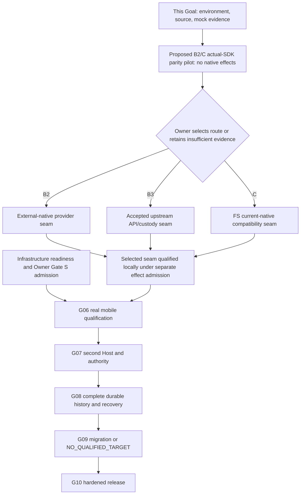

# F04 — Executable future Goal DAG and estimates

Status: **PLAN_COMPLETE; NO_FUTURE_GOAL_STARTED**. Product route remains undecided.
Effort below is engineering days for one intentional writer, not elapsed promises.
External Owner/upstream/production readiness can dominate the critical path.

## Ordering and milestone reconciliation

The accepted [implementation roadmap](../../v0.1/implementation-roadmap.md) and
[current status](../../train/current-status.md) govern actual admission:
**G06 → G07 → G08 → G09 → G10**. Historical train-manifest fields are not new
authority; current G06 targets ZenBook14 rather than the older SKYFORGE label.

The Goal-local M0–M5 labels describe work themes, not a replacement numbering
scheme. Their executable order is **M0 → M1 → M2 → M4(G06/G07) → M3(G08) → M5**.
Thus M3's history delivery cannot jump ahead of M4's accepted G06/G07 gates.
M0/F03 is route-decision preparation, not completion of M1's real SDK/runtime
qualification. Planning history fixtures now is not G08 implementation.

Only one B2/B3/C product branch would be admitted. No new real-native effect,
production change or native lifecycle action is inherited from this diagram.

## One next candidate Goal

**Proposed ID: FLEETSPLICE-B2-C-CONTRACT-PARITY-PILOT-001** — **not started**.

- **Owner/path/type:** one future FS Implementer; a dedicated study directory and
  explicitly admitted private fixture workspace. Paseo SDK/source remains a
  pinned dependency/reference; no upstream working tree is changed. Docs and
  fixture work only, no FS product patch in this pilot.
- **Entry:** Owner approves this one no-effect pilot and private project-scoped
  SDK dependency/build scope. Freeze a fresh Paseo release/main pair and FS head;
  use this Goal's qualified Node/SQLite baseline and the same synthetic contract.
- **Visible result:** an Owner-runnable report/fixture view compares actual SDK
  registration/open/close/result behavior with the existing FS adapter using an
  injected mock native port. It shows the same thread/incarnation and blocked
  unsupported controls. It must not advertise the mock as a real TUI.
- **Work:** compile/load a minimal provider through the real public SDK; reproduce
  reload/close and exact-turn input constraints; exercise FS against sanitized
  native-0.163 layout/response fixtures; prepare, but do not apply, the C product
  compatibility patch specification. Price B2 custom RPC versus B3 API extension.
- **Bounded tests:** one registration/lifecycle test, one shared identity/unknown
  effect fixture matrix, one history-contract source check. No benchmark/soak,
  real server, credentials, Native Effect or full Paseo monorepo CI.
- **Exit:** SOURCE + ACTUAL_SDK_MOCK evidence, exact unmet fields, cost interval and
  Owner route-decision pack. Retain INSUFFICIENT_EVIDENCE if the SDK cannot express
  required custody/control; do not silently choose C or redesign the platform.
- **No-go:** package lifecycle needs global changes, plugin requires credential
  inspection/native start, source license/provenance unclear, or any unapproved
  effect. Mark that packet BLOCKED and finish independent comparison evidence.
- **Estimate:** **2–4 days**, low-to-medium confidence. This is the shortest missing
  bridge from this source/design spike to route choice, not a fresh audit of all
  prior research.

## Conditional product packets after that decision

| Packet / Goal | Entry and owner/type | One visible exit | Tests / no-go | Incremental effort |
| --- | --- | --- | --- | --- |
| Proposed FLEETSPLICE-SELECTED-NATIVE-SEAM-001, C variant | Owner selects C and admits FS product paths packages/native-adoption plus focused tests | Existing original native thread discovered under the current install family, exact identity shown and cooperative controls qualified | PID-layout/native-field fixtures then one separately authorized local acceptance; no blind PID fallback, no unapproved native probe/effect | 2–5 days |
| Same proposed seam Goal, B2 variant | Owner selects B2; admits a separate plugin repository/path, no implicit upstream edits | External existing thread appears through provider with safe close and honest disabled controls | Actual SDK compile + exact-target/no-replay fixtures; separately authorized local runtime check; stop if generic controls cannot be made honest | 5–10 days for qualified control seam; do not also charge the overlapping 3–6-day narrow-provider estimate |
| Same proposed seam Goal, B3 variant | Owner chooses upstream route and an accepted maintainer/patch plan exists | External custody/native target fields and supported public seam available without a private fork | One seam API/core test set and affected app projection tests; no upstream commitment means BLOCKED, not assumed approval | 8–20 days, plus unknown review wait |
| Existing [FLEETSPLICE-V0_1-M1-REMOTE-MOBILE-MVP-006](../../../goals/FLEETSPLICE-V0_1-M1-REMOTE-MOBILE-MVP-006.md) | Selected seam + accepted local dogfood; production infrastructure and separate Gate S/Owner admission; approved Hub/Edge/Web paths | Real remote phone/browser on existing responsive surface controls exact original thread and returns to TUI | One admitted authenticated outbound-WSS remote loop, harmless approval/interrupt, reconnect; no copied credentials/public Edge listener; unavailable Tencent/OIDC means BLOCKED | 3–7 days remaining work/qualification plus external wait; do not reimplement completed predeploy/mobile UI |
| Existing [FLEETSPLICE-V0_1-M2-MULTI-HOST-007](../../../goals/FLEETSPLICE-V0_1-M2-MULTI-HOST-007.md) | Accepted G06 and separately qualified second Host; approved authority/selection paths | Owner selects either Host, sees exact environment and explicitly takes control | One two-host stale-generation/takeover/revocation matrix; no second Host or identity proof means BLOCKED | 3–8 days |
| Existing [FLEETSPLICE-V0_1-M3-DURABLE-SESSION-008](../../../goals/FLEETSPLICE-V0_1-M3-DURABLE-SESSION-008.md) | Accepted G07, admitted storage/recovery decisions; selected route's history paths | Owner retrieves an old exact event/tool payload after restart with bounded daemon/browser hot state | Complete-history fixture with stable IDs/cursors/blob digests, byte caps and injected loss/commit failures; one matched 10k+ workload/process-tree measurement when admitted; truncation or false completion blocks | 5–15 days, route dependent |
| Existing [FLEETSPLICE-V0_1-M4-PROVIDER-MIGRATION-009](../../../goals/FLEETSPLICE-V0_1-M4-PROVIDER-MIGRATION-009.md) | Accepted G08; qualified target and explicit confirmation if activation is proposed | Actual qualified migration or visible NO_QUALIFIED_TARGET | One quiescence/target identity/unknown-predecessor test; never treat a new epoch as proof an old effect stopped | 2–5 days |
| Existing [FLEETSPLICE-V0_1-HARDENING-010](../../../goals/FLEETSPLICE-V0_1-HARDENING-010.md) | Accepted G09 and separately admitted release operations | Owner-operable install/update/rollback/backup and hardened mobile/two-host release | One release-focused regression and required admitted wall-clock dogfood/soak; current short mock smoke is insufficient | 3–7 days plus release/Owner wait |

All repository/path ownership above is proposed, not a current write grant.
Any later product packet must cite the accepted architecture 0.1 baseline or an
Owner-accepted route amendment that explicitly admits its architecture/scope.
The single selected seam estimate is an alternative, not three cumulative tasks.
For C, illustrative critical-path engineering effort is **20–51 days** including
the 2–4-day pilot and G06–G10 remaining substance; arithmetic excludes completed
predeploy work, external waits and unexpected scope. B2 is roughly **23–56 days**;
B3 **26–66 days** plus upstream wait. These wide ranges convey uncertainty, not
a product-route recommendation from fake precision.

## Minimal execution recipe and evidence per packet

1. Freeze fresh PR/source SHA, goal-specific path ownership and entry authorization.
2. Use existing doctor and qualified-node wrapper; restore only the admitted
   project lock closure. No global toolchain change to force a green result.
3. Run only the affected type/build check and named fixture tests. For this
   baseline, reproducible commands are npm run development:doctor, tokens:check,
   check, build and the exact focused test selections recorded in [02](02-DEVELOPMENT-DOCTOR-AND-BUILD.md).
4. Record native operations separately from fixture calls. A real acceptance
   needs fresh exact-thread authorization, native receipt and unchanged original
   TUI return; PR #20 supplies no reusable effect allowance.
5. Close with one exact-head independent read-only review appropriate to the
   changed product surface, scoped receipts and rollback/no-go result. Do not
   run a full release CI on each minor documentation edit.

Identity, fencing, single attempt and unknown-effect honesty remain required.
No speculative recovery layer or long-running stress machinery is required
without a concrete failure mode.

## Later AI4S work is a different roadmap

Issues [#2](https://github.com/JerrySkywalker/FleetSplice/issues/2)–
[#8](https://github.com/JerrySkywalker/FleetSplice/issues/8) were freshly read:
post-v0.1 brownfield science/engineering fabric (#2), external planner/orchestration
boundary (#3), fleet-native inference (#4), Edge-to-Edge inference leases (#5),
typed capability-aware placement (#6), scientific tools such as MATLAB/STK (#7),
and later competitive positioning (#8). All remain OPEN future work.
Local agent execution and client adoption above do not admit remote inference,
SKYFORGE/Ollama serving, scientific tool placement or an IDE/ADE rebuild. These
issues do not block the first phone loop and are not appended as new current Goals.
