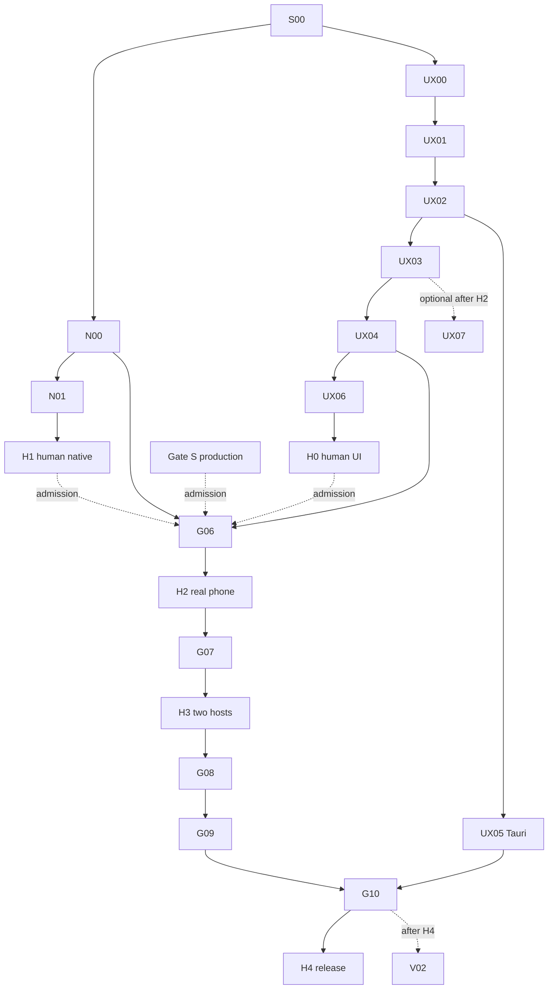

# 04 — Master Goal DAG and development PR plan

`PROGRAM_ID=FLEETSPLICE-FAST-PRODUCT-UX-TRAIN-001` — 17 child Goals, one maximum-12-hour Codex session at a time. Source work is Owner-approved; *actual human Gate pass is not.*

## Dependency graph

`G06→G07→G08→G09→G10` are the existing accepted *product Gate* order; optional planning and independent UI-source work are not substitute acceptance. G06 source preparation may run after N00+UX04 but its **real** deployment still requires H0/H1/Gate S and H2. G07 cannot begin product admission before accepted G06; G08 before G07 is prohibited. H0/H1 can be performed in either order.

## Milestones and checkpoints

| Stage | Deliverable | Owner experience |
| --- | --- | --- |
| M0 | S00/N00, UX00 in disjoint worktrees | no human until qualified |
| M1 | UX01→UX02→UX03→UX04 + UX05 + UX06, corrected Native handoff N01 | H0 usable UI first, H1 original TUI after separate Native authorization |
| M2 | existing G06 remote phone + Gate S | H2 real phone/cellular |
| M3 | existing G07 two independently enrolled Hosts | H3 real second Host |
| M4 | existing G08 indexed complete history, blobs, byte-bounded hot state + UI | evidence-backed historical recovery |
| M5 | existing G09 + G10 installer/hardening | H4 long-session/use/install/release |

## Worktrees, PR dependencies and source writers

- Local roots: `C:\Dev\src\FleetSplice` canonical read-only if worktree owned elsewhere; `C:\Dev\worktrees` active isolated; `C:\Dev\cache`, `C:\Dev\build`, `C:\Dev\artifacts`.
- Continue **existing** PR #23 stacked on #22. Neither PR #19–#23, main nor production are implicitly merged by this roadmap. UX00 and N00 may prepare concurrently in nonoverlapping files.
- UX01 owns `AppShell.tsx` and `style.css`, UX02 `NativeAdoption.tsx`/Presentation/Composer, UX03 control/attention and overlapping files, UX04 responsive CSS. **Serialize their merges** to avoid dual writers.
- UX05 `apps/desktop/**` may progress alongside UX03/UX04 after UX02 interface contract stabilizes. One integrator handles the final Web/Tauri handshake; never blindly cherrypick another branch.
- One focused source PR for each UI visible increment. After named targeted checks + one independent exact-head review, an authorized **source-only** UI PR may merge to *development train only*. Native PR23 has its original no-auto-merge rule. G06–G10 live changes require their own Gate. No merge to default `main`.
- H0–H4 must be actual human observations, never automated by TUI browser fixture.

## Estimated pace and exclusions

Optimistic previously discussed target roughly **15–31 engineering days** for a narrow v0.1 critical path, conditional on reusing G05C and G06 predeploy, not a guaranteed elapsed or Codex schedule. Do not inflate scope with generic IDE, terminal emulation, desktop browser tool suite, many-Agent scheduler, Expo migration or multi-region Relay. Defer optional UX07/V02. Production infrastructure wait is outside estimate. Avoid redundant CI and speculative defensive layers per [fast contract](02-FAST-DEVELOPMENT-CONTRACT.md).
