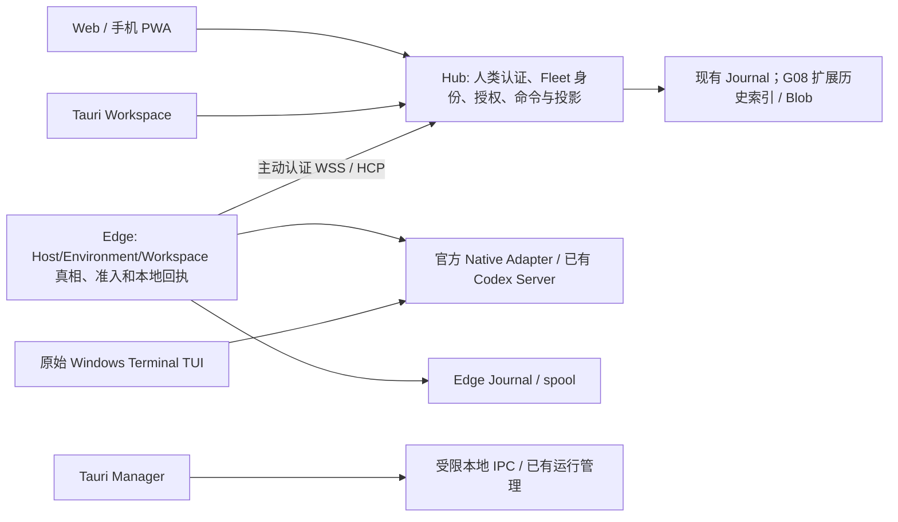
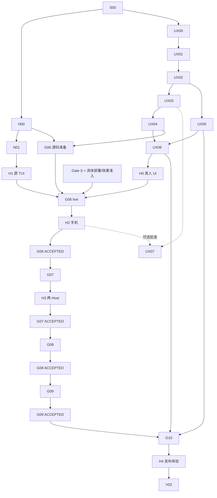

# FleetSplice 后续开发完整设计与路线图

设计日期：2026-10-21，Asia/Shanghai。本文是现有 FPX 的详细化方案；不启动其中任何产品 Goal、
不更新实际进度、不把计划勾选为通过。已批准边界见 [Owner decision](01-OWNER-TECHNOLOGY-DECISION.md)。

## 1. 当前事实与设计目标

本次重新取得的开发分支是 `train/pre-gate-s-development-001@16f9f6c66ceaae16030d6f3391db1cf19f651207`。
默认 main 仍为旧架构快照，不能作为当前产品功能基线。PR #24–#26 已合入开发分支，提供 FPX、
17 个 Goal 文件与离线 helper。实际开发时仍须重新抓取，不永久固定到这个快照。

PR #22 的 genuine SDK / official sandbox loader 已通过，但 Native 端为 Mock；
PR #23 当前仍是 `2bf6cdf5cddce330e4b26d66a266dee87ce4f7fe` 的 plan-only Draft，尚无 C 修正通过。
因此：本地源码方向按 Owner FPX 选择 C 继续，完整 C 产品路线仍是 conditional，不能称 native live PASS。
旧“UI/UX frozen”只在限定本地新源码范围被解冻；Gate S 与真实 H0–H4 并未因此通过。

**目标产品：已有开发环境中的 Native-first Agent Control Cockpit。**
首先让 Owner 离开键盘后能从手机安全观察/控制正确的原生线程；随后实现两 Host、完整历史、
诚实恢复、可验证迁移和可靠发布。编辑器、PTY、浏览器、Git GUI、通用调度器不进入 v0.1 必须范围。

## 2. 三层交付范围

| 层 | v0.1 交付 | 本轮边界 |
| --- | --- | --- |
| 原生正确性 | 现有 TUI late adoption、精确身份/目标、回执、最小耐久准入、不重放未知效果 | N00 修正、N01/H1 资格化 |
| 产品体验 | Fleet/Session 导航、对话/工具、Composer、Attention、响应式 Web 和 Tauri 集成 | UX00–UX06；复用已有 UI，局部改造 |
| 真实部署与耐久性 | G06 手机、G07 两 Host、G08 完整历史、G09 迁移/无目标、G10 发布 | 严格按原产品 Gate 顺序 |

UX07 为 H2 以后可选只读 Changes/Diff/PR；V02 为 G10 后未来规划。它们不阻塞 v0.1。

## 3. 系统架构

箭头 E→H 表示连接由 Edge 主动建立；消息可在已认证连接双向传送。手机不直连开发机端口。
Tauri Workspace 与 Web 使用相同产品授权，Manager 的 OS IPC 是另一条受限本地边界。
原生 Agent 执行文件/shell/tools，FS 不实现一个竞争工具 runtime。

### 写路径

显式用户动作 → typed FleetCommand → Hub 身份/权限/Controller/fence → Edge 精确绑定与最终准入
→ **先耐久记录 attempt** → 唯一 native dispatch → accepted Turn → 观察/对账 → FleetReceipt。

传输错误不是未执行证明。未知时不重试、不换 commandId 绕过、不以 timeout 推断结束。
同一 logical command 的重复应查回执；不同内容重用 ID 应拒绝。原始 TUI 可独立操作，因此 FS
Controller 是合作式权限，不能宣称排除了原生外部输入。

### 读路径

native structured observation → Edge 事实/水位 → Hub 投影或耐久历史 → scoped read/SSE
→ client-session → React/Tauri 视图。局部 UI 状态只包括选择、布局、草稿和 pending。
通知不具稳定身份/重放游标时，明确缺口并受界 resnapshot，不发明 native exactly-once。

## 4. 事实与契约归属

| 信息 | 权威来源 | 客户端责任 |
| --- | --- | --- |
| Host/Environment/principal/generation、Workspace | Edge + 已认证注册契约 | 显示精确上下文，切换时隔离缓存 |
| TUI/Server PID+创建、端点、Writer、native Thread | 官方只读接口 + OS/Owner 真实证据 | 不能从 UUID 或已在线标记猜测 |
| Controller/fence/grant、写许可 | Hub/Edge 的既有准入 | 只发显式意图，不以本地按钮状态授权 |
| native Turn/item、完成/UNKNOWN | native receipt/观察与耐久对账 | pending 与 native ID 分离，Done 仅据事实 |
| 模型/能力/审批响应 | 实际 native 能力契约 | 不静态猜目录、不创造 approval 选项 |
| 历史/页/Blob | G08 canonical durable store；native 引用原样保留 | 有界热窗口、按需读取与滚动锚点 |
| 外观/布局/草稿 | 既有本地偏好策略，按 Session 隔离 | 不向 Hub 同步凭据，不离线重放命令 |

协议/schema 的修改只由拥有该文件的单一 writer 完成，并让受影响消费者在同一个明确候选上验证。
不在 UX 中临时造第二套权限模型，不在 Native 中为未来抽象建立通用框架。

## 5. UX 的完整可见范围

- **Fleet shell**：Host→Environment→Workspace→Session、快速切换/最近使用，选择与控制身份分离。
- **对话**：稳定 item/turn 更新、流式到 final 无重复；安全 Markdown/代码、工具卡、真实时间来源。
- **Composer**：多行/IME/草稿、观察到的能力、Viewer 与 UNKNOWN 禁用写、明确提交/接受/完成差异。
- **Attention**：approval、外部推进、未知、离线、完成；每个需要只有一个主动作，不静默 takeover。
- **手机**：对话优先、drawer/sheet、软键盘/安全区、长代码局部横滚、PWA 元数据而非敏感离线缓存。
- **桌面**：Tauri 2 Manager + Workspace；既有 Web 复用，privileged IPC 不暴露给远程网页。
- **G08 历史**：旧事件/工具全文可定位与按页读取；UI virtualization 不能替代完整存储。

保持 React 19/TypeScript/Vite、Node 24、SQLite、Tauri 2、现有 token 和 HCP。
新增库只解决一个已测得或明确必须的任务，记录许可证/代价；不进行框架/包管理器迁移。

## 6. Goal DAG 与阶段交付

G06S/G06L/G06A 是**同一个 G06 文件的阶段**，不是新增 Goal。
H Gate 是人工/外部证据，不能把它放进无人值守步骤后自动转绿。
默认当前单 writer 按依赖串行推进；独立路径只表示可选择另一项，不代表已获多代理执行授权。

## 7. 一个 Goal 一个 Markdown：完整清单

文件名统一 `goals/fpx/FLEETSPLICE-FPX-<编号>-001.md`。
既有长 ID、manifest 和 helper 继续使用，不建立第二套进度源。

| Goal | 交付与主要清单 | 依赖 / 接受门禁 | 独立文件 |
| --- | --- | --- | --- |
| S00 | 最新基线、PR 栈、工作树、writer、证据入口 | 无 | [S00](../../../goals/fpx/FLEETSPLICE-FPX-S00-001.md) |
| N00 | PID 家族、loaded 无 resume、no-echo、产品路径耐久准入、事件缺口 | S00；继续 PR23，不自动合并 | [N00](../../../goals/fpx/FLEETSPLICE-FPX-N00-001.md) |
| N01 | 修正候选的本地原生操作卡、身份链、单独效果许可、同 TUI 返回 | N00；真人 H1 | [N01](../../../goals/fpx/FLEETSPLICE-FPX-N01-001.md) |
| UX00 | 信息架构、状态动作表、token/fixture/视口契约 | S00 | [UX00](../../../goals/fpx/FLEETSPLICE-FPX-UX00-001.md) |
| UX01 | 导航、快速切换、布局、选择/控制身份 | UX00 | [UX01](../../../goals/fpx/FLEETSPLICE-FPX-UX01-001.md) |
| UX02 | timeline、工具卡、Composer、pending/receipt | UX01 | [UX02](../../../goals/fpx/FLEETSPLICE-FPX-UX02-001.md) |
| UX03 | Attention、审批、Review、控制/未知呈现 | UX02 | [UX03](../../../goals/fpx/FLEETSPLICE-FPX-UX03-001.md) |
| UX04 | 窄屏/折叠/键盘、安全区、PWA 最小元数据 | UX03 | [UX04](../../../goals/fpx/FLEETSPLICE-FPX-UX04-001.md) |
| UX05 | Tauri Workspace/Manager 与 IPC 边界 | UX02 | [UX05](../../../goals/fpx/FLEETSPLICE-FPX-UX05-001.md) |
| UX06 | 可运行合成演示与 H0 反馈/小修正 | UX04+UX05；真人 H0 | [UX06](../../../goals/fpx/FLEETSPLICE-FPX-UX06-001.md) |
| G06 | 既有远程接缝、Gate S pack、真实手机闭环 | 源码 N00+UX04；live H0/H1/Gate S；产出 H2/G06_ACCEPTED | [G06](../../../goals/fpx/FLEETSPLICE-FPX-G06-001.md) |
| G07 | 第二真实 Host、精确目标、takeover/fence/revoke | G06_ACCEPTED/H2；产出 H3/G07_ACCEPTED | [G07](../../../goals/fpx/FLEETSPLICE-FPX-G07-001.md) |
| G08 | 完整历史/Blob、页/锚点、有界热状态、恢复 | G07_ACCEPTED/H3；产出 G08_ACCEPTED | [G08](../../../goals/fpx/FLEETSPLICE-FPX-G08-001.md) |
| G09 | 迁移提案/静止/绑定，或真实 NO_QUALIFIED_TARGET | G08_ACCEPTED；产出 G09_ACCEPTED | [G09](../../../goals/fpx/FLEETSPLICE-FPX-G09-001.md) |
| G10 | release candidate、安装/备份/回滚/soak/独立审查 | G09+UX05/UX06 与真实 H gates；产出 H4 | [G10](../../../goals/fpx/FLEETSPLICE-FPX-G10-001.md) |
| UX07 | 可选只读 Git/Diff/PR；不加写操作 | UX03+H2+Owner 选择；默认延后 | [UX07](../../../goals/fpx/FLEETSPLICE-FPX-UX07-001.md) |
| V02 | 排序 G11–G16/未来研究，只选择下一候选 | G10/H4；默认延后 | [V02](../../../goals/fpx/FLEETSPLICE-FPX-V02-001.md) |

每个文件已补充任务、负责范围、反例、Done、阻碍与下游。详细状态契约及模板见
[10 — Goal 文件与回执规范](10-GOAL-FILE-AND-EXECUTION-MODEL.md)；
功能到 Goal 的覆盖与排期见 [11 — 覆盖矩阵](11-COVERAGE-ESTIMATES-AND-FUTURE.md)。

## 8. 当前应如何启动

若没有更晚的有效回执：先 S00，然后 N00 与 UX00 两条就绪路径；优先尽早得到 UX01–UX03
的可运行模拟 UI，同时完成 Native 关键反例。之后准备 H0/H1，再进入真正的手机闭环。
规划补充本身不表示某 Goal 已执行；后续 Owner 的 [200 小时执行授权](12-OWNER-200H-EXECUTION-AUTHORIZATION.md)
要求先合并文档再推进。实际执行状态只依私有 state 与精确回执，不由本页提前标完成。

遇到 Owner/基础设施阻碍时，保存 exact cause、已完成源码和需要的单一操作卡，切换到独立就绪项。
当没有允许的就绪项时停下，不为填满 12 小时重复 CI，不跨越 G07/G08 的接受门禁。
