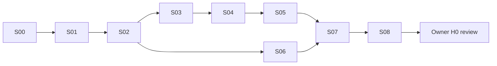

# SUI Goal Train

入口：[README](README.md) · 规范：[design.md](../../ux/design.md) · 状态：[manifest](manifest.json)。
当前仅规划 PR 获准创建、推送和正常合并；全部 S00–S08 为 `NOT_STARTED`，等待后续 60h 授权。

## DAG 与可见增量

| Goal | 依赖 | 可见结果 | 计划小时 |
| --- | --- | --- | ---: |
| [S00](../../../goals/shadcn/FLEETSPLICE-SUI-S00-001.md) | 新执行授权 | 可复验预设锁、生成来源清单和迁移入口 | 3 |
| [S01](../../../goals/shadcn/FLEETSPLICE-SUI-S01-001.md) | S00 | Web/Desktop 共用基础控件与明暗主题样板 | 6 |
| [S02](../../../goals/shadcn/FLEETSPLICE-SUI-S02-001.md) | S01 | 一个实际可操作的会话页，含审批/unknown/窄屏 | 8 |
| [S03](../../../goals/shadcn/FLEETSPLICE-SUI-S03-001.md) | S02 | 完整导航、Quick Switch 和自适应工作区 | 6 |
| [S04](../../../goals/shadcn/FLEETSPLICE-SUI-S04-001.md) | S03 | 对话、代码、工具和 Composer 全部统一 | 8 |
| [S05](../../../goals/shadcn/FLEETSPLICE-SUI-S05-001.md) | S04 | 单一 Attention、审批、配置和设置的完整体验 | 6 |
| [S06](../../../goals/shadcn/FLEETSPLICE-SUI-S06-001.md) | S02 | Desktop Manager 与 Gateway 的同一设计语言 | 5 |
| [S07](../../../goals/shadcn/FLEETSPLICE-SUI-S07-001.md) | S05、S06 | 旧样式退出、偏好迁移、双语和轻量反馈 | 5 |
| [S08](../../../goals/shadcn/FLEETSPLICE-SUI-S08-001.md) | S07 | 可运行合成候选、最终证据和 H0 体验交接 | 5 |
| 修正余量 | 仅当前范围真实失败 | 修正与必要复验 | 8 |

计划工作合计 52h；52+8=60h。分项是调度额度，不是工时承诺，也不要求耗尽。
S00 为直接依赖：不会另开漫长设计系统研究，复用本次固定研究，只核对执行时变化和实际生成结果。
S01 必须有可见控件样板，不能以抽象基础设施作为唯一成果。
S02 构建正式路径的最小竖切，S03–S06 扩展同一实现；不得丢弃试点后重写。

## 执行顺序与文件所有权

默认顺序 S00→S01→S02→S03→S04→S05→S06→S07→S08，始终一个 intentional writer。
S06 不依赖 S03–S05 的细节，若后者遇到确切外部阻碍，可转到 S06；共享组件由同一集成人串行处理。
Goal 级文件范围见各 MD。跨越 Native、Rust 生命周期、认证协议、Hub/Edge 调度语义的改动不在此 DAG 内。

每个 Goal 对应一个主要审阅单元和一个 source-only PR；小修可在同一 PR 内提交，不为每个复选框开 PR。
S00 的锁/文档若没有独立源码差异，可与 S01 的一个 PR 一起提交，分别保留 Goal 回执。
后续源码 PR 的创建及开发分支正常合并必须在未来 Owner 授权中明确包含。
不得强推、绕过分支保护、自动合并历史 PR19–23、切换产品路线或修改 `main`。

## 状态模型

- `NOT_STARTED → ACTIVE → SOURCE_COMPLETE`：范围内源码、定向验证、准确回执完成。
- `BLOCKED_EXACT`：记录具体原因、受阻范围和证据；继续其他真正独立的就绪 Goal。
- `READY_FOR_OWNER`：S08 已准备新候选，H0 没有执行或批准。
- `ACCEPTED`：仅有 Owner 对准确候选的实际接受证据才能使用。
- `BUDGET_EXPIRED`：保存部分结果与阻碍；不得将时间耗尽写为完成。

私有 `state.json` 和每 Goal 回执维护实际进度；manifest 是初始计划，不因文件存在就把 Goal 置为完成。
旧 `scripts/fpx-train.mjs` 硬编码 FPX 路径，**不适用于这个 manifest**。本轮不改调度器；按本 DAG 直接选择，勿用旧 helper 输出授予权限。
最终候选视觉复核可以准备为 H0，但不改变 H1–H4、Gate S 或 G06→G10 的原依赖。
